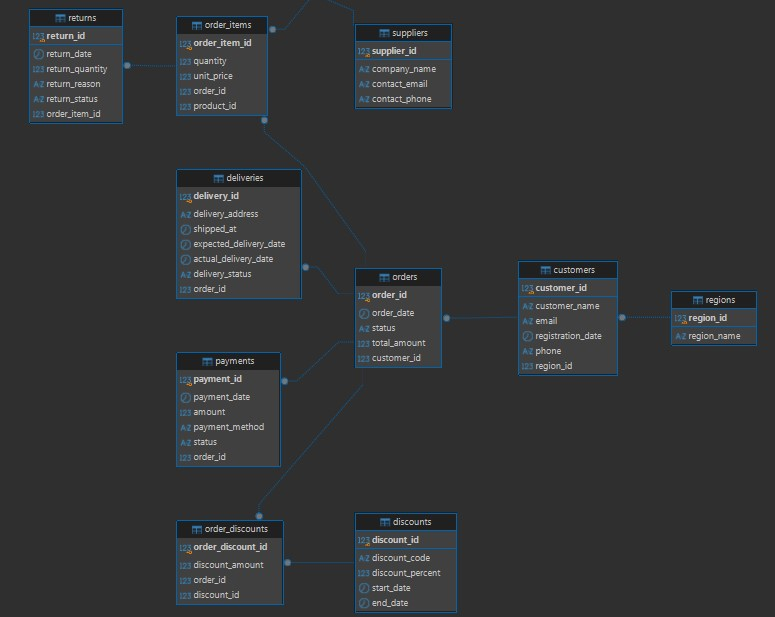
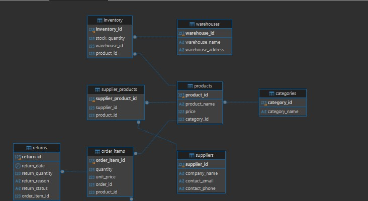

# E-Commerce Analytics | Аналитика интернет-магазина

Учебный аналитический проект на PostgreSQL, посвящённый исследованию бизнес-показателей интернет-магазина, поведения клиентов, продаж и производительности SQL-запросов.

## О проекте

Цель проекта — построить реляционную базу данных интернет-магазина, наполнить её тестовыми данными и провести комплексный анализ бизнес-процессов с использованием SQL.

Отдельное внимание уделено исследованию производительности запросов PostgreSQL, анализу планов выполнения и изучению механизмов статистики планировщика.

## Технологии

- **PostgreSQL** — система управления базами данных.
- **SQL** — создание структуры БД и аналитические запросы.
- **DBeaver** — среда работы с базой данных.
- **EXPLAIN ANALYZE** — анализ планов выполнения запросов.
- **Extended Statistics** — исследование расширенной статистики PostgreSQL.

## Структура базы данных

База данных состоит из 15 связанных таблиц, отражающих основные бизнес-процессы интернет-магазина.

### ER Diagram

**Часть 1.** Товары, категории, поставщики, склады и складские остатки.

**Часть 2.** Клиенты, регионы, заказы, платежи, доставки и возвраты.

## Аналитические задачи

Проект включает 33 аналитические задачи, охватывающие:

- Анализ продаж и выручки.
- Исследование поведения клиентов.
- Сегментацию покупателей.
- Анализ эффективности товаров и категорий.
- Анализ платежей и возвратов.
- Оценку эффективности доставки.
- Анализ складских остатков.
- Исследование поставщиков.
- Комплексную оценку бизнес-показателей.

## Оптимизация запросов

Отдельная часть проекта посвящена исследованию производительности PostgreSQL.

В ходе работы изучались:

- `EXPLAIN ANALYZE` и планы выполнения.
- `Sequential Scan` и `Index Scan`.
- `Nested Loop`, `Hash Join` и `Merge Join`.
- `HashAggregate`.
- Обычная и расширенная статистика PostgreSQL.
- `ndistinct`, `dependencies` и `MCV`.
- Временные таблицы и материализация промежуточных результатов.
- Ошибки оценки количества строк планировщиком.

## Полученные навыки

- Проектирование реляционных баз данных.
- Написание сложных аналитических SQL-запросов.
- Работа с CTE и оконными функциями.
- Использование агрегатных функций и условной фильтрации.
- Анализ планов выполнения PostgreSQL